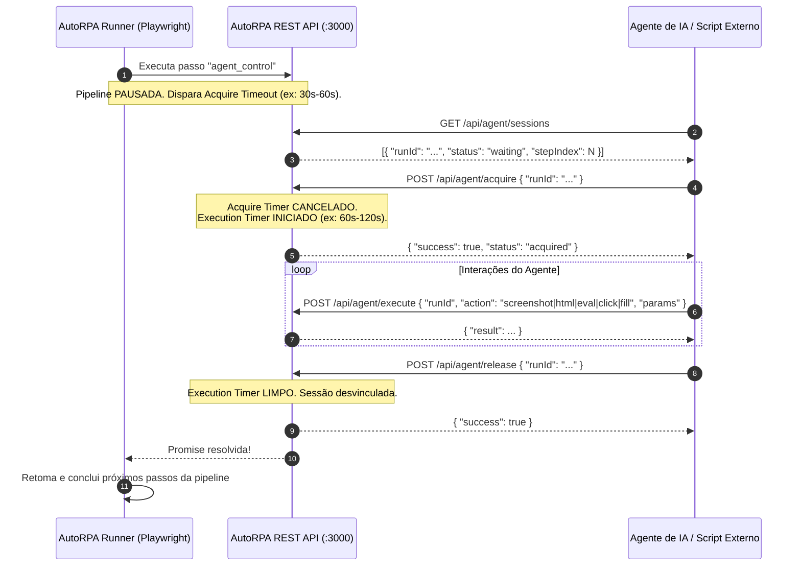

# AutoRPA — Agent Handoff Mode (Guia de Integração e Controle de Sessão)

O **AutoRPA** suporta o modo **Handoff Agente** (`agent_control`), uma arquitetura híbrida de automação onde passos determinísticos de RPA (login, navegação pesada, pré-preenchimento) rodam em alta velocidade e, ao atingir uma etapa complexa (desafio CAPTCHA, decisão inteligente, 2FA, navegação não-estruturada), o motor do Playwright **pausa a execução** e **cede a sessão do navegador em tempo real** para um Agente de IA (como Claude, Antigravity ou scripts autônomos).

O agente assume o controle via API REST, inspeciona o estado da página, realiza as ações necessárias e devolve o controle para que a pipeline continue sua execução normalmente.

---

## 🧭 Ciclo de Vida da Sessão (Session Lifecycle)



---

## ⚡ Regras Críticas de Engajamento

1. **SEMPRE faça Acquire antes de interagir**: Chamar `/api/agent/execute` sem antes adquirir a sessão via `/api/agent/acquire` retornará erro `HTTP 400 (Session is not acquired yet)`.
2. **SEMPRE libere a sessão (`/api/agent/release`)**: Envolva toda a lógica do agente em um bloco `try / finally` para garantir a liberação da sessão. Se o agente não liberar a sessão, a pipeline ficará travada até atingir o `executionTimeout`.
3. **Respeite os Timeouts**:
   - **`acquireTimeout`** (padrão: 30s a 60s): tempo que o AutoRPA aguarda até um agente chamar `POST /api/agent/acquire`.
   - **`executionTimeout`** (padrão: 60s a 120s): tempo máximo para o agente concluir e chamar `POST /api/agent/release`.
4. **Autenticação**: Se o AutoRPA estiver configurado com senha (`SYSTEM_PASSWORD` no `.env`), envie sempre o header `x-system-password: <senha>` em todas as requisições HTTP.

---

## 📡 Especificação Completa dos Endpoints

A URL base padrão é `https://rpa.sarapatel.duckdns.org`.

### 1. Listar Sessões Aguardando Controle
- **Método**: `GET /api/agent/sessions`
- **Query Params Opcionais**: `?runId=<id>` (retorna apenas a sessão específica ou 404).
- **Resposta Sucesso (`200 OK`)**:
  ```json
  [
    {
      "runId": "12eb49fd-3bf0-4f92-8a1c-b2d1a4f88f0e",
      "stepIndex": 2,
      "status": "waiting"
    }
  ]
  ```

### 2. Assumir Controle da Sessão
- **Método**: `POST /api/agent/acquire`
- **Body**:
  ```json
  {
    "runId": "12eb49fd-3bf0-4f92-8a1c-b2d1a4f88f0e"
  }
  ```
- **Resposta Sucesso (`200 OK`)**:
  ```json
  {
    "success": true,
    "status": "acquired"
  }
  ```

### 3. Executar Ações no Navegador
- **Método**: `POST /api/agent/execute`
- **Body Genérico**:
  ```json
  {
    "runId": "12eb49fd-3bf0-4f92-8a1c-b2d1a4f88f0e",
    "action": "<eval | navigate | click | fill | screenshot | html>",
    "params": {}
  }
  ```

#### Ações Suportadas:

| Ação | Descrição | `params` | Exemplo de Retorno |
| :--- | :--- | :--- | :--- |
| `eval` | Executa JavaScript no contexto da página | `{ "script": "document.title" }` | `{ "result": "Título da Página" }` |
| `html` | Retorna o HTML completo do DOM atual | `{}` | `{ "result": "<!DOCTYPE html><html>...</html>" }` |
| `screenshot` | Captura screenshot da página em Base64 | `{}` | `{ "result": { "base64": "data:image/png;base64,..." } }` |
| `navigate` | Redireciona a página para uma nova URL | `{ "url": "https://exemplo.com" }` | `{ "result": { "success": true } }` |
| `click` | Clica em um seletor CSS na página | `{ "selector": "#btn-confirmar" }` | `{ "result": { "success": true } }` |
| `fill` | Preenche um campo de input com texto | `{ "selector": "input[name='q']", "value": "Texto" }` | `{ "result": { "success": true } }` |

### 4. Devolver Controle e Retomar Pipeline
- **Método**: `POST /api/agent/release`
- **Body**:
  ```json
  {
    "runId": "12eb49fd-3bf0-4f92-8a1c-b2d1a4f88f0e"
  }
  ```
- **Resposta Sucesso (`200 OK`)**:
  ```json
  {
    "success": true
  }
  ```

---

## 🛠️ Código Pronto para Uso em Agentes

### Implementação em Node.js / JavaScript
```javascript
import fetch from 'node-fetch'; // ou nativo no Node 18+

const BASE_URL = process.env.AUTORPA_URL || 'http://localhost:3000';
const PASSWORD = process.env.AUTORPA_PASSWORD || '';

const headers = {
  'Content-Type': 'application/json',
  ...(PASSWORD ? { 'x-system-password': PASSWORD } : {})
};

async function handleAgentHandoff(targetRunId = null) {
  // 1. Identificar sessão em espera
  let runId = targetRunId;
  if (!runId) {
    const res = await fetch(`${BASE_URL}/api/agent/sessions`, { headers });
    const sessions = await res.json();
    const waiting = sessions.find(s => s.status === 'waiting');
    if (!waiting) {
      console.log('Nenhuma sessão aguardando controle de agente.');
      return;
    }
    runId = waiting.runId;
  }

  console.log(`[Agente] Assumindo controle da execução: ${runId}`);

  // 2. Adquirir controle da sessão
  const acquireRes = await fetch(`${BASE_URL}/api/agent/acquire`, {
    method: 'POST',
    headers,
    body: JSON.stringify({ runId })
  });

  if (!acquireRes.ok) {
    const err = await acquireRes.json();
    throw new Error(`Falha ao adquirir sessão: ${err.error}`);
  }

  const exec = async (action, params = {}) => {
    const r = await fetch(`${BASE_URL}/api/agent/execute`, {
      method: 'POST',
      headers,
      body: JSON.stringify({ runId, action, params })
    });
    const data = await r.json();
    if (!r.ok) throw new Error(data.error || `Erro na ação ${action}`);
    return data.result;
  };

  try {
    // 3. Inspeção e Ação Autônoma
    const url = await exec('eval', { script: 'window.location.href' });
    const title = await exec('eval', { script: 'document.title' });
    console.log(`[Agente] Navegador em: "${title}" (${url})`);

    // Exemplo: ler dados, clicar em botão ou resolver desafio
    // await exec('fill', { selector: '#captcha-input', value: '123456' });
    // await exec('click', { selector: 'button[type="submit"]' });

  } finally {
    // 4. SEMPRE liberar a sessão de volta para a pipeline
    console.log(`[Agente] Liberando sessão ${runId} de volta para a pipeline...`);
    await fetch(`${BASE_URL}/api/agent/release`, {
      method: 'POST',
      headers,
      body: JSON.stringify({ runId })
    });
    console.log('[Agente] Controle liberado com sucesso.');
  }
}

handleAgentHandoff();
```

---

### Implementação em Python
```python
import os
import time
import requests

BASE_URL = os.getenv("AUTORPA_URL", "http://localhost:3000")
PASSWORD = os.getenv("AUTORPA_PASSWORD", "")

headers = {
    "Content-Type": "application/json"
}
if PASSWORD:
    headers["x-system-password"] = PASSWORD

def run_agent_handoff(target_run_id=None):
    # 1. Localizar sessão aguardando
    run_id = target_run_id
    if not run_id:
        r = requests.get(f"{BASE_URL}/api/agent/sessions", headers=headers)
        sessions = r.json()
        waiting = next((s for s in sessions if s.get("status") == "waiting"), None)
        if not waiting:
            print("Nenhuma sessão aguardando controle de agente.")
            return
        run_id = waiting["runId"]

    print(f"[Agente] Adquirindo sessão {run_id}...")

    # 2. Acquire
    acq = requests.post(f"{BASE_URL}/api/agent/acquire", json={"runId": run_id}, headers=headers)
    acq.raise_for_status()

    def execute(action, params=None):
        payload = {"runId": run_id, "action": action, "params": params or {}}
        res = requests.post(f"{BASE_URL}/api/agent/execute", json=payload, headers=headers)
        data = res.json()
        if not res.ok:
            raise RuntimeError(data.get("error", f"Falha na ação {action}"))
        return data.get("result")

    try:
        # 3. Interagir com a página
        title = execute("eval", {"script": "document.title"})
        print(f"[Agente] Página ativa: {title}")

        # Capturar screenshot para análise visual
        shot = execute("screenshot")
        # Base64 disponível em shot["base64"]

    finally:
        # 4. Release sempre
        print(f"[Agente] Devolvendo controle da sessão {run_id}...")
        requests.post(f"{BASE_URL}/api/agent/release", json={"runId": run_id}, headers=headers)
        print("[Agente] Sessão liberada.")

if __name__ == "__main__":
    run_agent_handoff()
```

---

### Execução via Terminal / cURL (Scripts Bash Rápidos)
```bash
# 1. Listar sessões aguardando
RUN_ID=$(curl -s http://localhost:3000/api/agent/sessions | jq -r '.[0].runId')
echo "RunID detectado: $RUN_ID"

# 2. Assumir controle
curl -s -X POST http://localhost:3000/api/agent/acquire \
  -H "Content-Type: application/json" \
  -d "{\"runId\": \"$RUN_ID\"}"

# 3. Executar comando (ex: pegar título)
curl -s -X POST http://localhost:3000/api/agent/execute \
  -H "Content-Type: application/json" \
  -d "{\"runId\": \"$RUN_ID\", \"action\": \"eval\", \"params\": {\"script\": \"document.title\"}}"

# 4. Devolver controle
curl -s -X POST http://localhost:3000/api/agent/release \
  -H "Content-Type: application/json" \
  -d "{\"runId\": \"$RUN_ID\"}"
```

---

## 🎯 Playbooks e Casos de Uso Comuns

### 1. Resolução de Desafio Visual / CAPTCHA
1. O agente chama `execute('screenshot')` para capturar a tela renderizada.
2. O modelo multimodal (ou serviço OCR) localiza as coordenadas ou o texto do desafio.
3. O agente executa `execute('fill', { selector: '#captcha-input', value: token })` ou `execute('click', { selector: '#verify-btn' })`.
4. O agente verifica se o desafio sumiu via `execute('eval', { script: '!document.querySelector(".captcha")' })`.
5. O agente chama `release` para que a pipeline continue.

### 2. Navegação Dinâmica Baseada em Conteúdo
1. O agente obtém o DOM ou lista de links via `execute('eval', { script: 'Array.from(document.querySelectorAll("a")).map(a => ({ text: a.innerText, href: a.href }))' })`.
2. O agente escolhe o link correto com base no objetivo da tarefa.
3. Chama `execute('click', { selector: linkSelector })` ou `execute('navigate', { url: targetHref })`.
4. Valida se a nova tela carregou e chama `release`.

---

## 📥 Como Baixar Esta Skill na Aplicação

Ao executar qualquer pipeline que contenha a etapa **Handoff Agente** (`agent_control`), a janela de configuração da execução exibe o card roxo **Modo Handoff Agente Ativo** com o botão direto para **Baixar Skill (.md)** ou **Copiar Instruções**, permitindo fornecer o manual imediatamente a qualquer agente ou copiloto externo.
